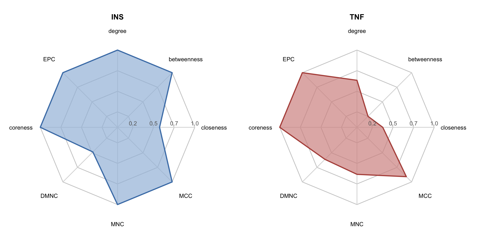

# PPI network analysis {#ppi-analysis}

Protein–protein interaction (PPI) networks are essential for deciphering the functional relationships among disease-related targets. `TCMDATA` provides a comprehensive PPI analysis pipeline that integrates data retrieval from STRING, network filtering, topological metric computation, community detection, and publication-ready visualization.

---

## Retrieving PPI data from STRING

`TCMDATA` provides `get_ppi()` function, a thin wrapper around `clusterProfiler::getPPI()`, to retrieve Protein-Protein Interaction (PPI) information from the STRING database and return an `igraph` object containing known and predicted protein–protein interactions, with edge weights representing combined confidence scores (range 0–1).

User can retrieve PPI network for a given set of genes using `get_ppi()` by specifying the taxonomic ID (e.g., `9606` for human, `10090` for mouse):
```{r ppi-data, eval=FALSE, collapse=FALSE}
library(TCMDATA)

data("dn_gcds")

ppi <- get_ppi(dn_gcds[1:50], taxID = 9606)
```


In this example, we use a demo ppi from Diabetic Nephropathy (DN) gene set to illustrate the workflow:
```{r ppi-data-demo, eval=TRUE, collapse=FALSE}
library(TCMDATA)

data("demo_ppi")
ppi <- demo_ppi
ppi
```

The returned `igraph` object contains a `score` edge attribute representing STRING combined confidence scores, where higher values indicate stronger evidence for the interaction.

---

## Network filtering

Raw PPI networks often contain low-confidence edges that introduce noise. `ppi_subset()` provides a two-stage filter:

1. **Edge score cutoff** — removes edges below a confidence threshold.
2. **Top-*n* degree filter** — retains only the *n* most connected nodes.

In this case, we keep edges with a STRING score ≥ 0.7 and then retain the top 100 nodes by degree:
```{r ppi-filter, eval=TRUE, collapse=FALSE}
ppi_filtered <- ppi_subset(ppi, score_cutoff = 0.7, n = 100)

cat("Before filtering:", vcount(ppi), "nodes,", ecount(ppi), "edges\n")
cat("After  filtering:", vcount(ppi_filtered), "nodes,", ecount(ppi_filtered), "edges\n")
```

| Parameter | Description | Default |
|-----------|-------------|---------|
| `score_cutoff` | Minimum edge confidence to retain | 0.7 |
| `n` | Top-*n* nodes by degree (NULL = all) | NULL |
| `rm_isolates` | Remove nodes with degree 0 after filtering | TRUE |

---

## Target-set proximity to a disease PPI module {#ppi-target-set-proximity}

In addition to constructing a PPI network for a selected gene list, an important network pharmacology question is whether a **target set** is globally close to a disease module in the human PPI background. This is especially useful for comparing:

1. Different herbs or formulas against the same disease.
2. Formula designs before and after optimization.
3. Candidate herb combinations, compound combinations, or target sets.

`TCMDATA` provides `evaluate_tcm_target_sets_by_ppi()` for this set-level analysis. Unlike `rank_tcm_targets_by_ppi()`, which ranks individual herb targets, this function evaluates the relationship between a target set `H` and a weighted disease module `D`.

The function reports five complementary network metrics:

| Metric | Meaning |
|--------|---------|
| `overlap_n` | Number of direct shared targets between `H` and `D` |
| `directlink_edges` | Number of one-step PPI links from non-overlap targets in `H` to disease targets in `D` |
| `jaccard` | Direct set similarity, `|H ∩ D| / |H ∪ D|` |
| `weighted_proximity` | Disease-weighted PPI proximity between `H` and `D` |
| `z_proximity` | Degree-matched random-background Z-score for the observed proximity |

The weighted proximity is calculated from shortest-path distances on the PPI network:

```text
proximity(h, D) =
  weighted.mean(1 / (1 + shortest_path_distance(h, d)),
                disease_weight[d])

weighted_proximity(H, D) =
  weighted.mean(proximity(h, D), target_weight[h])
```

To control for the fact that high-degree proteins are naturally closer to many network modules, the function samples random target sets with matched degree bins and calculates:

```text
z_proximity = (observed_proximity - mean(random_proximity)) /
              sd(random_proximity)
```

A positive `z_proximity` means that the target set is closer to the disease module than expected from same-degree random target sets.

### Example: evaluating Lingzhi target set against DN

For the DN case study, we can combine GeneCards and Open Targets scores into a weighted disease module, then evaluate whether the Lingzhi target set is close to this DN module in the built-in human STRING PPI background:

```{r ppi-target-set-proximity-demo, eval=FALSE, collapse=FALSE}
library(TCMDATA)

## weighted DN disease module
data(dn_gcds_tbl)
data(dn_otp_tbl)

disease_w <- prepare_disease_weights(
  GeneCards = dn_gcds_tbl,
  OpenTargets = dn_otp_tbl
)

## Lingzhi target set
lingzhi_df <- search_herb("lingzhi", type = "Herb_pinyin_name")
lingzhi_w <- prepare_herb_target_weights(lingzhi_df, method = "binary")

## set-level PPI proximity evaluation
set_eval <- evaluate_tcm_target_sets_by_ppi(
  target_sets = list(Lingzhi = lingzhi_w),
  disease_targets = disease_w,
  n_perm = 1000,
  seed = 20260525
)

set_eval$result[, c(
  "set", "n_targets_in_ppi", "overlap_n",
  "overlap_target_fraction", "directlink_edges",
  "first_order_target_coverage", "jaccard",
  "weighted_proximity", "z_proximity", "p_empirical"
)]
```

A simplified output may look like this:

```text
     set n_targets_in_ppi overlap_n overlap_target_fraction directlink_edges
 Lingzhi              894       610                  0.6823            3983

 first_order_target_coverage jaccard weighted_proximity z_proximity p_empirical
                      0.9810  0.1058             0.2325       17.88      0.001
```

This result would be interpreted as follows:

- `overlap_n = 610`: many Lingzhi targets directly overlap with DN targets.
- `first_order_target_coverage = 0.981`: most Lingzhi targets either directly overlap with the DN module or are one PPI step away from it.
- `jaccard = 0.1058`: direct set similarity is modest because the DN disease module is large.
- `z_proximity = 17.88`: Lingzhi targets are much closer to the weighted DN module than degree-matched random target sets.

For comparing multiple candidate formulas or combinations, pass a named list:

```{r ppi-multi-target-set-demo, eval=FALSE, collapse=FALSE}
multi_eval <- evaluate_tcm_target_sets_by_ppi(
  target_sets = list(
    formula_A = formula_A_targets,
    formula_B = formula_B_targets,
    optimized_formula = optimized_targets
  ),
  disease_targets = disease_w,
  n_perm = 1000
)

multi_eval$result[order(multi_eval$result$Rank_set), ]
```

In multi-set analysis, `Rank_set` ranks target sets by `Score_set`, which is currently equal to `z_proximity`. In single-set analysis, `Rank_set` is always 1 and should not be overinterpreted; the key statistics are `z_proximity`, `p_empirical`, `overlap_n`, and `first_order_target_coverage`.

---

## Topological metrics {#topology}

Topological analysis of PPI networks is fundamental for identifying disease-critical nodes. By quantifying centrality metrics such as degree, betweenness, and closeness, researchers can pinpoint hub proteins that serve as key regulators, bottleneck nodes that control information flow, and bridge proteins that connect functional modules. These topologically important nodes often represent promising therapeutic targets.

Traditionally, most network pharmacology studies rely on **Cytoscape**, which is a widely adopted desktop application, and its **CytoHubba** plugin<sup>[1]</sup> to compute centrality metrics for target prioritization. While effective, this workflow requires exporting data from other software, manual operation in a GUI environment, and re-importing results, which disrupts the analytical pipeline and reduces reproducibility.

`TCMDATA` addresses these limitations with `compute_nodeinfo()`, which calculates a comprehensive set of centrality measures directly within the R ecosystem. This approach offers two key advantages:

1. **Workflow integration** — All analyses remain in R, eliminating context-switching and ensuring full reproducibility through scripted pipelines.
2. **Extended metric coverage** — Beyond the 11 metrics provided by CytoHubba, `compute_nodeinfo()` includes additional measures, enabling more comprehensive topological characterization.

In this example, we calculate a panel of 19 topological metrics for the filtered PPI network, using the `score` edge attribute as weights where applicable:
```{r ppi-metrics, eval=TRUE, collapse=FALSE}
ppi_scored <- compute_nodeinfo(ppi_filtered, weight_attr = "score")
ppi_scored |> str()
```

The following metrics are computed and stored as vertex attributes:

| Category | Metric | Description |
|----------|--------|-------------|
| **Local** | `degree` | Number of direct neighbors |
| | `strength` | Sum of incident edge weights |
| | `clustering_coef` | Local clustering coefficient (transitivity) |
| | `coreness` | k-core decomposition level |
| **Global** | `betweenness` | Fraction of all-pairs shortest paths passing through the node |
| | `closeness` | Inverse of average shortest-path distance to all other nodes |
| | `eccentricity` | Maximum shortest-path distance to any reachable node |
| | `eccentricity_centrality` | Reciprocal eccentricity used for integrated ranking (larger = more central) |
| | `eigen_centrality` | Influence score based on connections to high-scoring neighbors |
| | `pagerank` | Importance based on random-walk visitation probability |
| **CytoHubba**<sup>[1]</sup> | `MCC` | Maximal Clique Centrality — sum of (|C|−1)! over all maximal cliques containing the node |
| | `MNC` | Maximum Neighborhood Component — size of the largest connected component among neighbors |
| | `DMNC` | Density of MNC — edge density of the MNC, penalized by component size (α = 1.7) |
| | `BN` | BottleNeck — frequency of being a high-flow node in shortest-path trees |
| | `EPC` | Edge Percolated Component — average component size under random edge removal |
| | `radiality` | Radiality — average gain in reachability relative to graph diameter |
| | `Stress` | Stress centrality — total count of shortest paths passing through the node |

### Integrated ranking

`rank_ppi_nodes()` normalizes the selected metrics to [0, 1], applies user-defined weights (equal by default), and produces a composite score for target prioritization. Raw `eccentricity` is retained for reporting, while `eccentricity_centrality = 1 / eccentricity` is used in the default score so that larger values consistently indicate greater centrality. The returned `scoring` element records the resolved metrics and normalized weights, and the ranking table includes one `<metric>_norm` audit column for every scored metric.

```{r ppi-rank, eval=TRUE, collapse=FALSE}
rank_res <- rank_ppi_nodes(ppi_scored, use_weight = TRUE)

# Extract ranked table
ppi_ranked <- rank_res$graph
rank_df <- rank_res$table

rank_df[1:10, c("name", "degree", "betweenness_w", "closeness_w",
                "MCC", "MNC", "EPC", "Score_network", "Rank_network")]
```

### Correlation-adjusted metric weights

When several metrics are strongly positively correlated, `calculate_metric_weights()` groups them using complete-linkage clustering and gives each group equal total weight. The suggested weights reduce redundant contributions but do not estimate biological importance. The returned correlation matrix, paired-observation counts, and cluster assignments can be inspected before use. Pass the resolved metric names from `names(metric_weights$weights)` to `rank_ppi_nodes()`, as shown below.

```{r ppi-metric-weights, eval=FALSE}
metric_weights <- calculate_metric_weights(
  ppi_scored,
  metrics = c("degree", "betweenness", "closeness",
              "eccentricity_centrality", "MCC", "MNC", "EPC"),
  correlation_threshold = 0.8
)

rank_res <- rank_ppi_nodes(
  ppi_scored,
  metrics = names(metric_weights$weights),
  weights = metric_weights$weights,
  use_weight = FALSE
)
```

### Radar plot of topological metrics

For a target of interest, `get_node_profile()` + `radar_plot()` produces a radar chart showing its normalized centrality fingerprint across multiple dimensions:

```{r ppi-radar, eval=FALSE, fig.width=10, fig.height=5, fig.align='center', out.width='95%', collapse=FALSE}
library(aplot)

# Pick the top 2 ranked nodes
top_nodes <- rank_df$name[1:2]

p_radar1 <- radar_plot(
  get_node_profile(rank_df, top_nodes[1]),
  fill_color = "#A3BEDD", line_color = "#4A7FB5",
  title = top_nodes[1]
)

p_radar2 <- radar_plot(
  get_node_profile(rank_df, top_nodes[2]),
  fill_color = "#D59390", line_color = "#B5524A",
  title = top_nodes[2]
)

plot_list(p_radar1, p_radar2, ncol = 2)
```

```{r, echo=FALSE, out.width='95%', fig.align='center'}

```

---

### Heatmap of topological metrics

The heatmap provides a global overview of selected nodes across multiple topological metrics simultaneously. `plot_node_heatmap()` generates a Z-score normalized heatmap using `ComplexHeatmap`, with hierarchical clustering to reveal nodes with similar centrality profiles:

```{r ppi-heatmap, fig.width=10, fig.height=12, fig.align='center', out.width='95%', collapse=FALSE}
# Select key metrics for visualization
selected_cols <- c("degree", "betweenness", "closeness", "MCC", "MNC", 
                   "DMNC", "EPC", "radiality", "Stress")

plot_node_heatmap(rank_df, select_cols = selected_cols)
```

---

## Community detection {#clustering}

Identifying densely connected subnetworks (modules) helps reveal functional protein complexes and signaling cascades. `TCMDATA` supports four complementary algorithms.

### Louvain modularity optimization

The Louvain algorithm<sup>[3]</sup> is a fast and scalable community detection method that optimizes network modularity through a hierarchical, greedy approach. It iteratively assigns nodes to communities that maximize the modularity gain, then aggregates communities into super-nodes and repeats the process. Due to its computational efficiency and ability to handle large-scale networks, Louvain has become one of the most popular algorithms for detecting functional modules in biological networks.

```{r ppi-louvain, eval=TRUE, collapse=FALSE}
ppi_louvain <- run_louvain(ppi_scored, resolution = 1.0)
louvain_scores <- add_cluster_score(ppi_louvain, cluster_attr = "louvain_cluster", min_size = 3)

head(louvain_scores)
```

The `resolution` parameter controls clustering granularity: values > 1 produce more, smaller clusters; values < 1 yield fewer, larger clusters.

### MCODE (Molecular Complex Detection)

MCODE (Molecular Complex Detection)<sup>[2]</sup> is a classic graph-clustering algorithm specifically designed for identifying densely connected regions in PPI networks. Originally implemented as a **Cytoscape plugin**, MCODE has become one of the most widely adopted methods for detecting protein complexes and functional modules in network pharmacology studies.

The algorithm operates in three phases: (1) **vertex weighting** based on local neighborhood density (k-core × density), (2) **seeded growth** from high-scoring seed nodes, and (3) **post-processing** via haircut (removing singly-connected peripheral nodes) or fluff (expanding with dense neighbors).

`TCMDATA` provides `run_mcode()`, a native R implementation of the MCODE algorithm, enabling seamless integration into scripted workflows without requiring external software. This eliminates the need to export networks to Cytoscape and manually run the plugin, significantly improving reproducibility and efficiency in PPI analysis pipelines.

```{r ppi-mcode, eval=TRUE, collapse=FALSE}
ppi_mcode <- run_mcode(ppi_scored, vwp = 0.2, haircut = TRUE, fluff = FALSE)
mcode_res <- get_mcode_res(ppi_mcode, only_clusters = TRUE)

head(mcode_res)
```


### MCL (Markov Clustering)

The Markov Clustering (MCL) algorithm<sup>[4]</sup> detects community structure by simulating stochastic flow (random walks) on the network. It alternates between two operations: **expansion** (matrix squaring to allow flow to spread) and **inflation** (element-wise exponentiation to strengthen strong connections and weaken weak ones). This process naturally separates the network into well-defined clusters based on flow patterns. MCL is particularly effective for PPI networks because protein complexes tend to form densely connected regions that trap random walks.

```{r ppi-mcl, eval=TRUE, collapse=FALSE}
ppi_mcl <- run_MCL(ppi_scored, inflation = 2.5)
mcl_scores <- add_cluster_score(ppi_mcl, cluster_attr = "MCL_cluster", min_size = 3)

head(mcl_scores)
```

The `inflation` parameter controls cluster granularity: higher values (e.g., 3–5) yield tighter, more granular clusters; lower values (e.g., 1.5–2) produce larger, more inclusive modules.

### Fast greedy modularity optimization

The fast greedy algorithm<sup>[5]</sup> detects communities by greedily optimizing network modularity. It starts with each node as an individual community, then repeatedly merges the pair of communities that produces the largest modularity gain. This bottom-up strategy is efficient for undirected networks and provides a simple modularity-based alternative to Louvain for PPI module detection.

`TCMDATA` implements this workflow through `run_fastgreedy()`, which calls `igraph::cluster_fast_greedy()` and writes the resulting membership labels back to the graph as `fastgreedy_cluster`. By default, the function uses the edge attribute `weight` as the confidence score; if `weight` is absent, it falls back to the STRING-style `score` attribute. Users can also provide a custom weight vector or set `weights = NA` for unweighted clustering.

```{r ppi-fastgreedy, eval=TRUE, collapse=FALSE}
ppi_fastgreedy <- run_fastgreedy(ppi_scored)
fastgreedy_scores <- add_cluster_score(
  ppi_fastgreedy,
  cluster_attr = "fastgreedy_cluster",
  min_size = 3
)

head(fastgreedy_scores)
```

The `weights` parameter controls whether PPI confidence scores contribute to modularity optimization. For example, `weights = "score"` explicitly uses the `score` edge attribute, while `weights = NA` performs unweighted fast greedy clustering.

## PPI network robustness analysis {#robustness}

Assessing the robustness of PPI networks to node perturbation is crucial for understanding the resilience of biological systems and identifying critical vulnerabilities. The `ppi_knock()` function simulates targeted node removal (knockout) and evaluates the impact on network integrity by comparing against randomized null models, following the drug attack model proposed by Xi et al. (2022)<sup>[6]</sup>.

### Algorithm overview

The algorithm tracks four network-level topological metrics — **ASPL** (Average Shortest Path Length), **AD** (Average Degree), **DC** (Degree Centralization), and **CC** (Closeness Centrality) — and proceeds in four stages:

1. **Baseline**: Compute the four metrics on the intact network.
2. **Real attack**: Remove the target nodes and re-compute metrics. The Robustness Index (RI) quantifies relative change: $RI = (M_{after} - M_{before}) / M_{before}$.
3. **Permutation null**: Rewire the network $n$ times (preserving degree sequence), shuffle edge weights, randomly knock out the same number of nodes, and compute the random RI distribution.
4. **Inference**: Compute $Z = (RI_{real} - \mu_{null}) / \sigma_{null}$ for effect-size standardization and a centered, two-sided empirical p-value directly from the permutation distribution. BH-adjusted empirical p-values are used by default; normal-approximation p-values remain available for compatibility.

The **Total Score** integrates all metrics: $Total = Z_{ASPL} - Z_{AD} - Z_{DC} - Z_{CC}$. A large positive value indicates the knocked-out targets are structurally critical. Its empirical p-value is calculated from the combined statistic in each permutation rather than from a normal approximation to the final Z-score.

### Example: knocking out IL6

```{r ppi-knock, eval=TRUE, collapse=FALSE}
res <- ppi_knock(
  ppi_scored,
  targets = "IL6",
  n_perm = 1000,
  seed = 42,
  p_method = "empirical"
)
res$Summary
cat("Total Score:", res$Total_Score, "\n")
cat("Total P-value:", res$Total_Pvalue, "\n")
```

Interpret `Normalized_RI` as the standardized topological change and use `P_empirical` / `P_adjust_empirical` for permutation inference. These statistics describe structural sensitivity of the supplied PPI network and should not be treated as experimental validation of a therapeutic target.

### Visualization: before vs. after knockout

To visually compare network topology before and after knockout, we plot the intact network (with the target highlighted in red) alongside the post-knockout network:

```{r ppi-knock-vis, eval=TRUE, fig.width=12, fig.height=6, fig.align='center', out.width='100%', collapse=FALSE}
library(ggtangle)
library(igraph)
library(ggplot2)
library(ggrepel)
library(aplot)

target_node <- "IL6"

## prepare before / after igraph objects
g_before <- ppi_ranked
V(g_before)$is_target <- ifelse(V(g_before)$name == target_node, "Target", "Other")

g_after <- delete_vertices(g_before, target_node)

## network before knockout
set.seed(2025)
p_before <- ggplot(g_before, layout = "fr") +
  geom_edge(alpha = 0.10, color = "grey65") +
  geom_point(aes(color = is_target, size = degree), alpha = 0.85) +
  geom_text_repel(aes(label = name), size = 2.5, max.overlaps = 25,
                  segment.alpha = 0.3, fontface = "italic") +
  scale_color_manual(values = c(Other = "#56B4E9", Target = "#D55E00"),
                     guide = "none") +
  scale_size_continuous(range = c(2, 8), guide = "none") +
  ggtitle("Before knockout") +
  theme_void() +
  theme(plot.title = element_text(hjust = 0.5, face = "bold", size = 12))

## network after knockout
set.seed(2025)
p_after <- ggplot(g_after, layout = "fr") +
  geom_edge(alpha = 0.10, color = "grey65") +
  geom_point(aes(color = degree, size = Score_network), alpha = 0.85) +
  geom_text_repel(aes(label = name), size = 2.5, max.overlaps = 25,
                  segment.alpha = 0.3, fontface = "italic") +
  scale_color_gradient(low = "#56B4E9", high = "#D55E00", name = "Degree") +
  scale_size_continuous(range = c(2, 8), name = "Score") +
  ggtitle(paste0("After knockout (", target_node, " removed)")) +
  theme_void() +
  theme(plot.title = element_text(hjust = 0.5, face = "bold", size = 12))

plot_list(p_before, p_after, ncol = 2, labels = c("A", "B"))
```

- **Panel A** shows the intact network with IL6 highlighted in red, revealing its central position and high degree.
- **Panel B** shows the network after removing IL6 — the loss of its connections visibly fragments local connectivity.


## PPI network visualization {#ppi-vis}

High-quality network visualization is essential for interpreting PPI analysis results and preparing publication-ready figures. While Cytoscape remains a popular choice for network visualization, it requires manual GUI operations that are difficult to reproduce and integrate into automated workflows.

`ggtangle`<sup>[7]</sup> addresses these limitations by providing a `ggplot2`-native framework for network rendering. Key advantages include:

- **Full `ggplot2` compatibility** — Seamless integration with the grammar of graphics; supports all `ggplot2` themes, scales, and annotations.
- **Reproducibility** — All visualizations are generated programmatically, ensuring consistent results across runs.
- **Publication-ready output** — Fine-grained control over node aesthetics, edge styling, and layout algorithms for SCI-standard figures.
- **Direct `igraph` support** — Accepts `igraph` objects directly without format conversion.

### Basic network with topological mapping

The following example maps node **degree** to color and **composite score** to size, using the Fruchterman-Reingold force-directed layout:

```{r ppi-net-basic, eval=TRUE, fig.width=10, fig.height=8, fig.align='center', out.width='95%', collapse=FALSE}
library(ggtangle)
library(ggplot2)
library(ggrepel)

set.seed(2025)
ggplot(ppi_ranked, layout = "fr") +
  geom_edge(alpha = 0.12, color = "grey60") +
  geom_point(aes(color = degree, size = Score_network), alpha = 0.85) +
  geom_text_repel(aes(label = name), size = 2.5, max.overlaps = 30, segment.alpha = 0.3) +
  scale_color_gradient(low = "#56B4E9", high = "#D55E00", name = "Degree") +
  scale_size_continuous(range = c(2, 8), name = "Score") +
  theme_void() +
  theme(
    legend.position = "right",
    legend.title = element_text(face = "bold", size = 10)
  )
```

### Community-colored network

Overlaying cluster assignments reveals modular organization. Hub nodes (top 15% by degree) are labeled using `ggrepel` to avoid text overlap:

```{r ppi-net-louvain, eval=TRUE, fig.width=11, fig.height=9, fig.align='center', out.width='95%', collapse=FALSE}
library(ggrepel)

set.seed(2025)
ggplot(ppi_louvain, layout = "fr") +
  geom_edge(alpha = 0.10, color = "grey65") +
  geom_point(aes(color = louvain_cluster, size = degree), alpha = 0.85) +
  geom_text_repel(aes(label = name), size = 2.5, max.overlaps = 30, segment.alpha = 0.3) +
  scale_color_brewer(palette = "Set2", name = "Module") +
  scale_size_continuous(range = c(2, 9), name = "Degree") +
  theme_void() +
  theme(
    legend.position = "right",
    legend.title = element_text(face = "bold", size = 10)
  )
```

### Hub-centric star layout

The star layout positions the highest-degree node at the center, emphasizing hub–spoke relationships:

```{r ppi-net-star, eval=TRUE, fig.width=10, fig.height=8, fig.align='center', out.width='95%', collapse=FALSE}
set.seed(2025)
ggplot(ppi_ranked, layout = "star") +
  geom_edge(alpha = 0.12, color = "grey60") +
  geom_point(aes(color = Score_network, size = degree), alpha = 0.85) +
  geom_text_repel(aes(label = name), size = 2.5, max.overlaps = 30, segment.alpha = 0.3) +
  scale_color_viridis_c(option = "C", name = "Score") +
  scale_size_continuous(range = c(2, 10), name = "Degree") +
  theme_void() +
  theme(
    legend.position = "right",
    legend.title = element_text(face = "bold", size = 10)
  )
```

### Layout algorithm comparison

Different layouts suit different analytical purposes. The following comparison illustrates four common algorithms:

```{r ppi-net-layouts, eval=TRUE, fig.width=12, fig.height=10, fig.align='center', out.width='100%', collapse=FALSE}
library(aplot)

set.seed(2025)
base_layers <- list(
  geom_edge(alpha = 0.10, color = "grey65"),
  geom_point(aes(color = degree, size = Score_network), alpha = 0.85),
  geom_text_repel(aes(label = name), size = 2, max.overlaps = 25, segment.alpha = 0.3),
  scale_color_gradient(low = "#56B4E9", high = "#D55E00", guide = "none"),
  scale_size_continuous(range = c(1.5, 6), guide = "none"),
  theme_void()
)

p_fr     <- ggplot(ppi_ranked, layout = "fr")     + base_layers
p_kk     <- ggplot(ppi_ranked, layout = "kk")     + base_layers
p_nicely <- ggplot(ppi_ranked, layout = "nicely") + base_layers
p_star   <- ggplot(ppi_ranked, layout = "star")   + base_layers

plot_list(p_fr, p_kk, p_nicely, p_star, ncol = 2, labels = c("A", "B", "C", "D"))
```

| Panel | Layout | Description | Best for |
|-------|--------|-------------|----------|
| A | Fruchterman-Reingold | Force-directed; minimizes edge crossings | Dense networks with many edges |
| B | Kamada-Kawai | Energy-based; preserves graph distances | Medium networks with clear clusters |
| C | Nicely | Automatic selection by `igraph` | General-purpose visualization |
| D | Star | Hub at center, others radially arranged | Hub-centric topology analysis |

---

## References

1. Chin CH, Chen SH, Wu HH, Ho CW, Ko MT, Lin CY. cytoHubba: identifying hub objects and sub-networks from complex interactome. *BMC Systems Biology* (2014), 8(Suppl 4), S11. doi: [10.1186/1752-0509-8-S4-S11](https://doi.org/10.1186/1752-0509-8-S4-S11).

2. Bader GD, Hogue CW. An automated method for finding molecular complexes in large protein interaction networks. *BMC Bioinformatics* (2003), 4, 2. doi: [10.1186/1471-2105-4-2](https://doi.org/10.1186/1471-2105-4-2).

3. Blondel VD, Guillaume JL, Lambiotte R, Lefebvre E. Fast unfolding of communities in large networks. *Journal of Statistical Mechanics: Theory and Experiment* (2008), 2008(10), P10008. doi: [10.1088/1742-5468/2008/10/P10008](https://doi.org/10.1088/1742-5468/2008/10/P10008).

4. van Dongen S. Graph clustering via a discrete uncoupling process. *SIAM Journal on Matrix Analysis and Applications* (2008), 30(1), 121–141. doi: [10.1137/040608635](https://doi.org/10.1137/040608635).

5. Clauset A, Newman MEJ, Moore C. Finding community structure in very large networks. *Physical Review E* (2004), 70(6), 066111. doi: [10.1103/PhysRevE.70.066111](https://doi.org/10.1103/PhysRevE.70.066111).

6. Xi Y, et al. Exploration of the Specific Pathology of HXMM Tablet Against Retinal Injury Based on Drug Attack Model to Network Robustness. *Frontiers in Pharmacology* (2022), 13, 826535. doi: [10.3389/fphar.2022.826535](https://doi.org/10.3389/fphar.2022.826535).

7. Yu G. ggtangle: Draw Network with Data. R package version 0.1.4 (2026). doi: [10.32614/CRAN.package.ggtangle](https://doi.org/10.32614/CRAN.package.ggtangle).

---

## Session information

```{r, collapse=FALSE}
sessionInfo()
```
